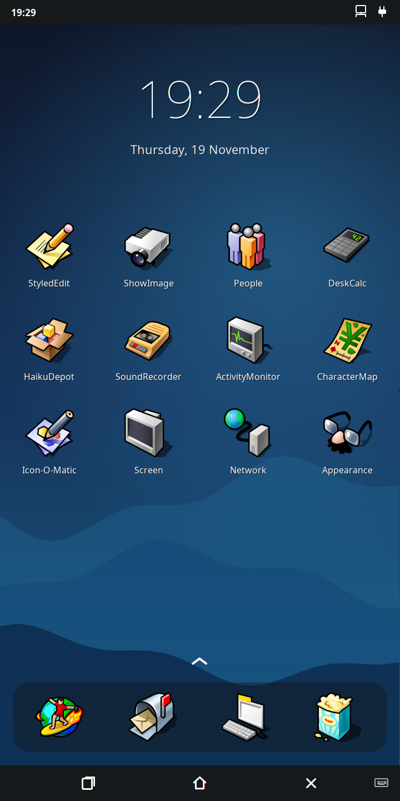
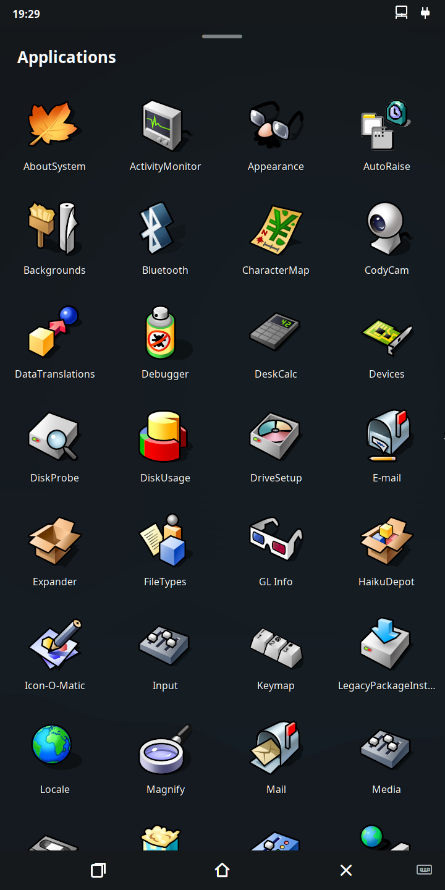
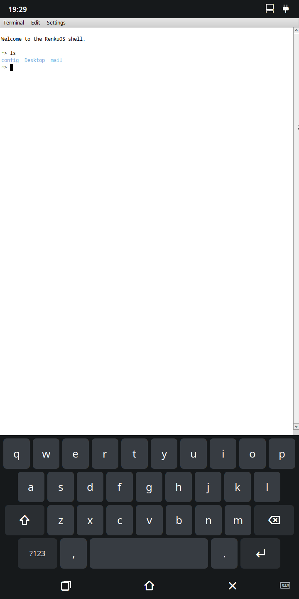
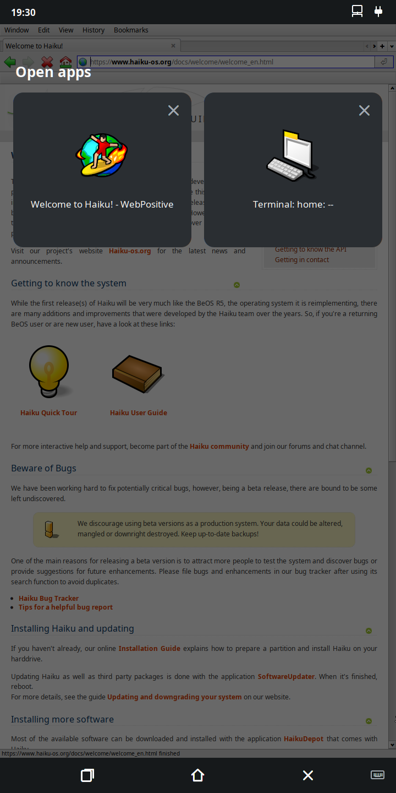

# Renku Mobile

A respin of [Renku OS](https://github.com/RenkuOS/Source) with a phone UI after
Plasma Mobile. The first target is x86_64 in QEMU at the original PinePhone's
720×1440; the PinePhone (arm64) port comes later.

Page with screenshots: https://idumych.github.io/RenkuMobile/

| Home | App drawer | Action drawer | Apps and keyboard | Task switcher |
|---|---|---|---|---|
|  |  |  |  |  |

## What's in it

| Part | Where | What it does |
|---|---|---|
| Status bar | `shell/src/Panels.cpp` | Clock, network and battery. Tap or pull down for the action drawer. |
| Navigation panel | `shell/src/Panels.cpp` | Task switcher, home and close-app buttons, as in Plasma; a keyboard toggle on the right. Swipe up from it for the task switcher. |
| Home screen | `shell/src/HomeScreen.cpp` | Clock, favourite apps and a dock over the wallpaper. Swipe up (or tap the chevron) for the app drawer with every app; pull down to close it. |
| Action drawer | `shell/src/ActionDrawer.cpp` | Date and time, quick settings (Network, Keyboard, Screenshot, Settings). |
| Task switcher | `shell/src/TaskSwitcher.cpp` | A card per open window: tap to switch, ✕ to close. |
| Window management | `shell/src/WindowTracker.cpp` | Makes every app window borderless and full-screen between the panels (and above the keyboard). |
| On-screen keyboard | `shell/src/Keyboard.cpp`, `vkbd/` | Letters and symbols; types through an input_server add-on, so any app gets the keys. |

The shell is one app, `MobileShell`, started by the launch daemon in place of
Tracker's desktop and the Deskbar (`packaging/user_launch`). It's packaged as
`renku_mobile.hpkg`, and the image is the Renku nightly with that package added.

### How it works on Renku

- **Screen.** QEMU's `virtio-vga` reports 720×1440 in its EDID and Renku's
  `virtio_gpu` driver takes it. (The VESA driver can only set modes in the VBE
  BIOS's list, which has no 720×1440.)
- **No window manager hooks in app_server,** so the shell polls the window list
  through the private API Deskbar uses (`get_window_order`, `get_window_info`,
  `do_window_action`) and resizes windows through their scripting suite (`Look`
  and `Frame` properties).
- **No compositing,** so the overlays (drawer, task switcher) draw a dimmed
  screenshot of what's behind them.
- **The image is written on Linux** with Renku's own `bfs_shell`; no VM clicks.
  BFS can't be grown offline, so the image keeps the ISO's 650 MB volume (about
  130 MB free).

## Building

Everything stays under the checkout (`third_party/`, `downloads/`, `build/`,
`vm/` are git-ignored). A Linux host with `gh`, QEMU, socat, ImageMagick and
the usual gcc build dependencies is enough. One-time setup:

```sh
# Renku nightly and its package repository
gh release download nightly -R RenkuOS/Source -D downloads \
	-p 'RenkuOS-x86_64-*.iso*' -p 'renkuos-x86_64-repo.tar*'
# Sources: Renku, and Haiku's buildtools (jam, gcc)
git clone --depth 1 https://github.com/RenkuOS/Source.git third_party/renku-src
git clone --depth 1 https://github.com/haiku/buildtools.git third_party/buildtools
mkdir -p third_party/bin && make -C third_party/buildtools/jam && cp third_party/buildtools/jam/bin.*/jam third_party/bin/
# Host tools: bfs_shell and package (nasm isn't used for these; a stub passes configure)
cd third_party/renku-src && mkdir generated.host && cd generated.host
HAIKU_NASM=$PWD/../../../scripts/nasm-stub ../configure --host-only
PATH=$PWD/../../bin:$PATH jam -q '<build>bfs_shell' '<build>package'
# Cross compiler (about an hour on 4 cores)
cd .. && mkdir generated.x86_64 && cd generated.x86_64
HAIKU_NASM=$PWD/../../../scripts/nasm-stub ../configure --cross-tools-source ../../buildtools --build-cross-tools x86_64
cd ../../.. && scripts/make-sysroot.sh
```

Then:

```sh
make package               # build/renku_mobile-0.1.0-1-x86_64.hpkg
scripts/build-image.sh     # vm/renku-mobile.img
DISPLAY_MODE=gtk scripts/qemu.sh start
```

`scripts/qemu.sh` also takes screenshots and drives the pointer and keys
(`shot`, `tap`, `drag`, `key`, `type`) for tests.

## Status

| | |
|---|---|
| x86_64 in QEMU, 720×1440, on Renku nightly build00094 | boots straight to the shell; `make test` passes (status bar, navigation panel, home, action drawer, keyboard, launching Terminal full-screen, typing into it with the on-screen keyboard, task switcher, closing an app) |
| App drawer, scrolling, Settings view | checked by eye from screenshots, not by `make test` |
| PinePhone | not started: needs a Renku arm64 image for the A64 (Renku builds a generic arm64 MMC image) |

`make test` (`tests/run.sh`) boots the image headless, taps through the shell
and checks screen pixels; its screenshots land in `shots/`.

Known shortcuts (each marked `shortcut:` in the code):

- Favourite apps are a fixed list.
- No notification list: Renku's notification_server has no API to read them back.
- Task switcher cards show the app icon and title, not a preview, and don't scroll.
- Battery reads the ACPI battery driver; QEMU has none, so it shows a plug.
