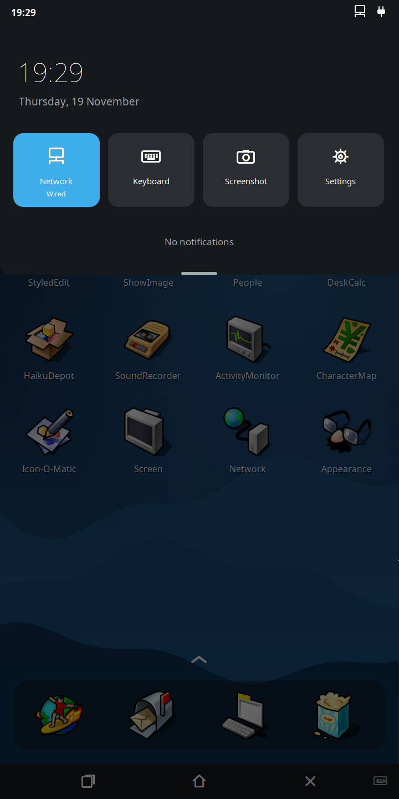

# Renku Mobile

A respin of [Renku OS](https://github.com/RenkuOS/Source) with a phone UI after
Plasma Mobile. The first target is x86_64 in QEMU at the original PinePhone's
720×1440; the PinePhone (arm64) port comes later.

Page with screenshots: https://idumych.github.io/RenkuMobile/

| Home | App drawer | Action drawer | Apps and keyboard | Task switcher |
|---|---|---|---|---|
|  |  |  |  |  |

## Try it

Download the ISO from the [latest release](https://github.com/idumych/RenkuMobile/releases/latest)
and check it with `sha256sum -c RenkuMobile-*.iso.sha256`. It's the Renku
nightly (build00094) with Renku Mobile added, for x86_64 PCs and VMs.

**QEMU** (tested): boot it as a disk for the phone screen at 720×1440. Boot
from a copy, because the disk is written to:

```sh
cp RenkuMobile-0.1.0-x86_64.iso phone.img
qemu-system-x86_64 -enable-kvm -cpu host -smp 2 -m 2048 -rtc base=localtime \
	-drive file=phone.img,format=raw \
	-device virtio-vga,xres=720,yres=1440 -device qemu-xhci -device usb-tablet
```

It boots straight to the home screen. Use the mouse as your finger: tap,
or press and drag to swipe.

Booted as a CD (`-cdrom RenkuMobile-0.1.0-x86_64.iso`), or from a USB stick
or DVD, Renku's Welcome window comes first because the medium is read-only:
choose **Try it out** to get to the phone shell. **Install** puts the regular
Renku on disk, with Renku Mobile in it.

Untested: VirtualBox and real hardware. Without `virtio-vga` the screen is
whatever size the VESA driver picks; the shell fills it, but it's laid out
for 720×1440.

## What's in it

| Part | Where | What it does |
|---|---|---|
| Status bar | `shell/src/Panels.cpp` | Clock, network and battery. Tap or pull down for the action drawer. |
| Navigation panel | `shell/src/Panels.cpp` | Task switcher, home and close-app buttons, as in Plasma; a keyboard toggle on the right. Swipe up from it for the task switcher. |
| Home screen | `shell/src/HomeScreen.cpp` | Clock, favourite apps and a dock over the wallpaper. Swipe up (or tap the chevron) for the app drawer with every app; flick to scroll it, pull down to close it. |
| Action drawer | `shell/src/ActionDrawer.cpp` | Date and time, quick settings (Network, Keyboard, Screenshot, Settings). |
| Task switcher | `shell/src/TaskSwitcher.cpp` | A card per open window: tap to switch, ✕ to close. |
| Window management | `shell/src/WindowTracker.cpp` | Makes every app window borderless and full-screen between the panels (and above the keyboard). |
| On-screen keyboard | `shell/src/Keyboard.cpp`, `vkbd/` | Letters and symbols; types through an input_server add-on, so any app gets the keys. Comes up when a text field gets focus and goes when it loses it, as in Plasma. As in Plasma's keyboard, the globe key opens a menu of the layouts above it, with Settings below them, and the space bar names the layout in use: the Terminal layout adds a row with Esc, Tab, Ctrl, Alt (Haiku's Command key), Home, End and the arrows. Ctrl and Alt hold for the next key, as Shift does. The microphone at the strip's end dictates, as FUTO's voice input does: a circle in place of the keys swells with the voice, a tap or 2 s of quiet after speech ends it, and whisper.cpp with FUTO's ACFT tiny.en turns it into text on the device (11 s of speech in about a second in QEMU). The menu's Emoji puts colour emoji in place of the letters, as Maliit (Plasma Mobile's keyboard) does: a grid scrolled sideways, recently used first, a bar of categories under it, and ABC back to the letters. Swiping across the letters types a word, as in FUTO Keyboard: an accent trail follows the finger, thinning and fading as it ages, the strip on top shows the likeliest words as you go, and on lift the best goes in with a space before it when it follows another word; tapping another swaps it in, backspace takes the whole word out. |
| Touch | `touch/` | An input_server filter that makes a finger's press land where the finger is, makes taps count as clicks, and right-clicks when a finger is held still (see below). |

The shell is one app, `MobileShell`, started by the launch daemon in place of
Tracker's desktop and the Deskbar (`packaging/user_launch`). It's packaged as
`renku_mobile.hpkg`, and the image is the Renku nightly with that package added.

### How it works on Renku

- **Screen.** QEMU's `virtio-vga` reports 720×1440 in its EDID and Renku's
  `virtio_gpu` driver takes it. (The VESA driver can only set modes in the VBE
  BIOS's list, which has no 720×1440.)
- **No window manager hooks in app_server,** so the shell polls the window list
  through the private API Deskbar uses (`get_window_order`, `get_window_info`,
  `do_window_action`) and resizes windows through their scripting suite (`Look`
  and `Frame` properties).
- **Compositing.** The image turns on Renku's composited desktop (the
  `appearance` settings file, written by `scripts/app-server-appearance.py`),
  so the overlays (drawer, task switcher) are transparent windows over the
  live apps. Without a compositor they fall back to a dimmed screenshot.
- **Touch screens** go through input_server's tablet add-on, which sends a
  press before the move to where it happened, and app_server takes the
  position of a press from the last move. A mouse hovers there first; a finger
  doesn't, so each tap landed where the last finger lifted and turned into a
  drag. The `renku_touch` filter sends the move first. Renku's HID driver
  also counts clicks only for buttons, not a touch screen's tip switch, so
  every tap said "clicks" 0 and WebKit didn't follow links; the filter counts
  them.
- **Long press.** A finger has no second button, so holding it still for half
  a second on an app's window right-clicks there (WebPositive's link menu,
  Terminal's paste). The filter holds a press back until the finger moves or
  lifts, then sends it as it was; a tap held back to its end goes out with
  its release 100 ms after the press, because menus poll for the buttons and
  miss a press that is already over. The shell's own windows get presses at
  once. While a finger is held, the shell shows a ring around it that fills
  up until the right-click, as Windows does. The ring's middle is clear, and
  on a composited desktop app_server lets presses through the clear pixels of
  a transparent window, so the press still reaches the app; without a
  compositor the ring stays off. (`scripts/qemu.sh touch`, `hold` and `flick` press like a finger, for
  tests.)
- **Text focus.** Windows tell input_server when an input-method-aware view,
  such as a `BTextView`, gets or loses focus, but it tells no one else. The
  keyboard add-on runs inside input_server, so it watches for these messages
  with a filter and passes them on to the shell.
- **The image is written on Linux** with Renku's own `bfs_shell`; no VM clicks.
  BFS can't be grown offline, so the image keeps the ISO's 650 MB volume (about
  130 MB free).

## Building

Everything stays under the checkout (`third_party/`, `downloads/`, `build/`,
`vm/` are git-ignored). A Linux host with `gh`, QEMU, socat, ImageMagick and
the usual gcc build dependencies is enough (CMake and Ninja for whisper.cpp;
PipeWire's `pactl` and `pw-play` let `make test` try dictation). One-time setup:

```sh
# Renku nightly and its package repository
gh release download nightly -R RenkuOS/Source -D downloads \
	-p 'RenkuOS-x86_64-*.iso*' -p 'renkuos-x86_64-repo.tar*'
# The colour emoji font the keyboard's emoji need, from HaikuPorts (Renku's
# app_server draws its colour bitmaps); the test image gets it from here
curl -L -o downloads/noto_emoji_color-2.042-1-any.hpkg \
	https://eu.hpkg.haiku-os.org/haikuports/master/x86_64/current/packages/noto_emoji_color-2.042-1-any.hpkg
# Sources: Renku, and Haiku's buildtools (jam, gcc)
git clone --depth 1 https://github.com/RenkuOS/Source.git third_party/renku-src
git clone --depth 1 https://github.com/haiku/buildtools.git third_party/buildtools
# whisper.cpp for dictation (the Makefile builds it with scripts/build-whisper.sh)
git clone --depth 1 --branch v1.9.5 https://github.com/ggerganov/whisper.cpp.git third_party/whisper.cpp
mkdir -p third_party/bin && make -C third_party/buildtools/jam && cp third_party/buildtools/jam/bin.*/jam third_party/bin/
# Host tools: bfs_shell and package (nasm isn't used for these; a stub passes configure)
cd third_party/renku-src && mkdir generated.host && cd generated.host
HAIKU_NASM=$PWD/../../../scripts/nasm-stub ../configure --host-only
PATH=$PWD/../../bin:$PATH jam -q '<build>bfs_shell' '<build>package'
# Cross compiler (about an hour on 4 cores)
cd .. && mkdir generated.x86_64 && cd generated.x86_64
HAIKU_NASM=$PWD/../../../scripts/nasm-stub ../configure --cross-tools-source ../../buildtools --build-cross-tools x86_64
cd ../../.. && scripts/make-sysroot.sh
# The dictation model, FUTO's ACFT tiny.en as ggml q8_0 (needs ~1 GB for PyTorch)
scripts/make-voice-model.sh
```

Then:

```sh
make package               # build/renku_mobile-0.1.0-1-x86_64.hpkg
scripts/build-image.sh     # vm/renku-mobile.img (IMG=… for another name: it's a bootable ISO)
DISPLAY_MODE=gtk scripts/qemu.sh start
```

`scripts/qemu.sh` also takes screenshots and drives the pointer and keys
(`shot`, `tap`, `drag`, `key`, `type`) for tests.

## Status

| | |
|---|---|
| x86_64 in QEMU, 720×1440, on Renku nightly build00094 | the 0.1.0 ISO boots straight to the shell as a disk, and to it after **Try it out** as a CD; `make test` passes on it (status bar, navigation panel, home, action drawer, keyboard, a finger's tap launching an app from the drawer, launching Terminal full-screen with the keyboard coming up, typing into it with the on-screen keyboard, a finger's drag selecting, a ring showing around a held finger and the finger right-clicking to paste, the globe key's layout menu, the Terminal layout's Ctrl+C and Tab, the emoji and back, swiping a word, dictating whisper.cpp's JFK sample through a virtual microphone, task switcher, closing an app and the keyboard going with it) |
| App drawer, scrolling and flicking, Settings view, keyboard following focus in StyledEdit and the task switcher | checked by eye from screenshots, not by `make test` |
| Android apps (Waydroid) | shelved: needs a Linux-compatible layer in Renku's kernel, plus binder; [Haiku-Linux-Bridge](https://github.com/AiLang-Author/Haiku-Linux-Bridge) (CC0, x86_64 only) could seed the syscall handlers |
| PinePhone | not started: needs a Renku arm64 image for the A64 (Renku builds a generic arm64 MMC image) |

`make test` first checks the swipe decoder on the host (`tests/swipe-test.cpp`:
made-up swipes of the 3,000 commonest words), then `tests/run.sh` boots the
image headless, taps through the shell and checks screen pixels; its
screenshots land in `shots/`.

Known shortcuts (each marked `shortcut:` in the code):

- Favourite apps are a fixed list.
- No notification list: Renku's notification_server has no API to read them back.
- Task switcher cards show the app icon and title, not a preview, and don't scroll.
- Battery reads the ACPI battery driver; QEMU has none, so it shows a plug.
- The touch filter works around Renku's tablet add-on, HID driver and
  app_server; all but the long press can go once they take a press's position
  from the press and count a tip switch's clicks.
- The keyboard's emoji are single characters: app_server draws sequences
  (skin tones, families, flags) as their parts, so they're left out.
  The nightly's Terminal draws only the emoji below U+10000: it misreads
  four-byte UTF-8 (fixed in a Renku PR; StyledEdit and other text views
  draw them all).
- Pages in WebPositive always see `e.buttons` 0 (HaikuWebKit never sets it),
  so web apps that check it, such as JS Paint, don't draw, with a finger or a
  mouse.
- Terminal's view isn't marked input-method aware, so the keyboard add-on
  knows Terminal by its signature.
- Tapping a text field that already has focus doesn't bring back a keyboard
  you hid: no message says so.
- Dictation is English only (tiny.en), and whisper.cpp is built for AVX2:
  on older x86 CPUs the microphone doesn't show. The model comes in the
  package (44 MB).
- Swipe typing knows 10,000 English words, matched by the shape of the path
  (not FUTO's neural decoder, whose licence doesn't fit). No suggestions
  while tapping letters, and no next-word prediction.

## Credits

- Swipe typing's words: the Google Books Ngram Corpus's most frequent English
  words, as cleaned in
  [orgtre/google-books-ngram-frequency](https://github.com/orgtre/google-books-ngram-frequency),
  [CC BY 3.0](https://creativecommons.org/licenses/by/3.0/)
  (`scripts/make-word-data.py` makes `shell/src/WordData.h` from it).
- The swipe trail's widths and timings are AOSP LatinIME's defaults
  (Apache 2.0), which FUTO Keyboard keeps.
- Emoji: Unicode's emoji-test.txt (Unicode License), drawn with Google's Noto
  Color Emoji (SIL Open Font License) from HaikuPorts.
- Dictation: [whisper.cpp](https://github.com/ggerganov/whisper.cpp) (MIT),
  OpenAI's [Whisper](https://github.com/openai/whisper) (MIT), and FUTO's
  [ACFT tiny.en](https://huggingface.co/futo-org/acft-whisper-tiny.en)
  fine-tune (Apache 2.0). The listening view and its loudness rules follow
  FUTO's voice input; none of FUTO's app code is used.
